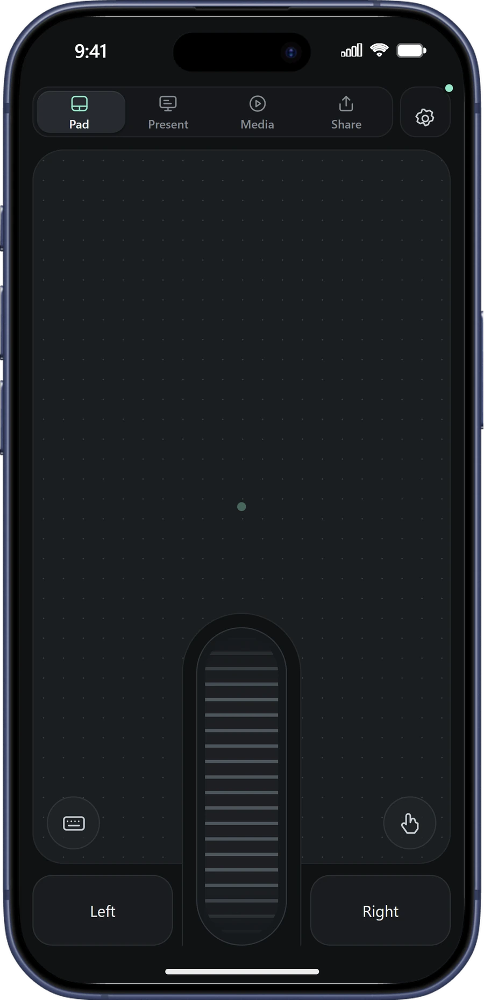
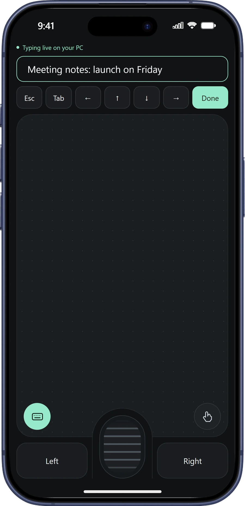
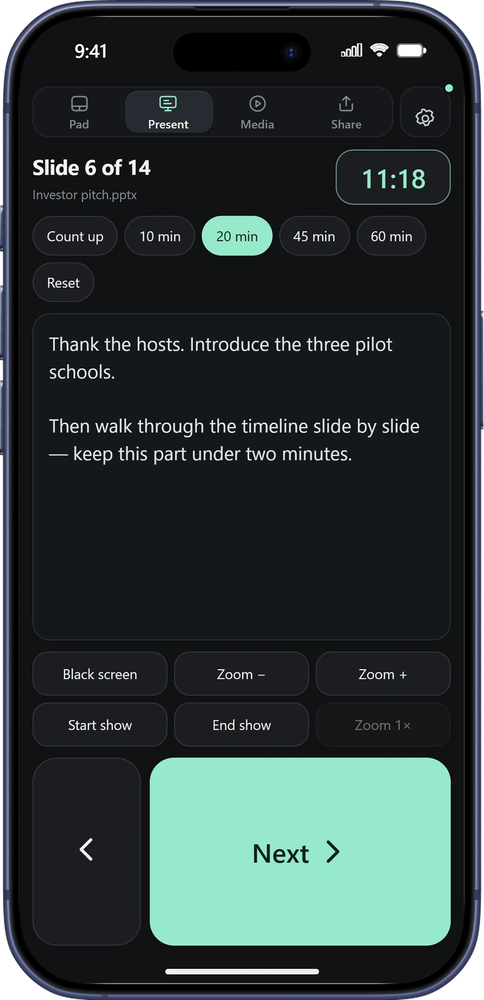
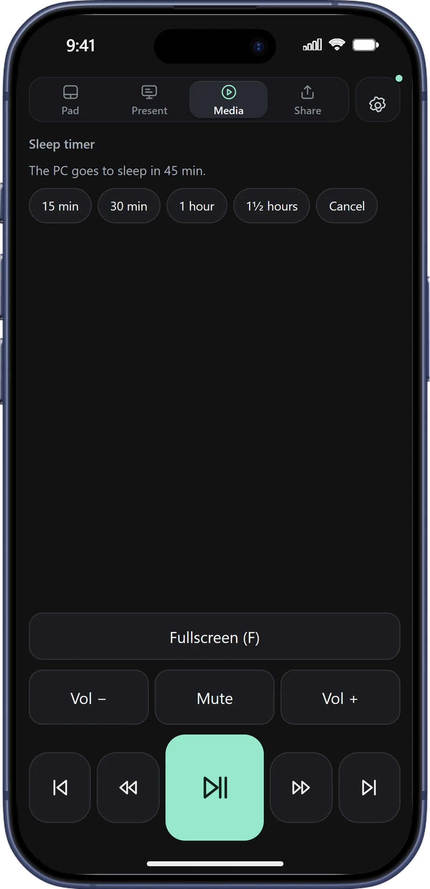
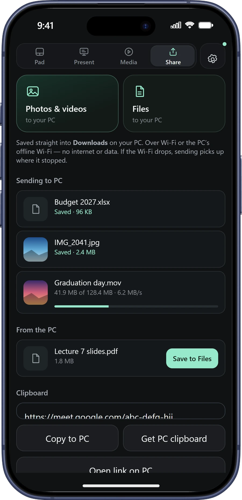

# MyCursor

**Your phone is the only mouse you need.**

Touchpad, keyboard, presentation clicker, media remote and file sharing for
Windows. Works over Wi-Fi, with no internet at all, or over Bluetooth on Android.
Free, no account.

### [⬇ Download MyCursor for Windows](https://github.com/Gacaca6/MyCursor/releases/latest/download/MyCursor.exe)

[Website](https://gacaca6.github.io/MyCursor/) ·
[Setup guide](GET-STARTED.md) ·
[All releases](https://github.com/Gacaca6/MyCursor/releases)

 

---

## Get started in a minute

1. **On the PC:** download **MyCursor.exe** and double-click it. If Windows says
   *"Windows protected your PC"*, choose **More info → Run anyway**, then **Yes**.
2. **On the phone** (same Wi-Fi): point the **Camera** at the code on the PC and
   open the link.
3. **Keep it on your Home Screen:** iPhone **Share → Add to Home Screen**,
   Android **⋮ → Add to Home screen**.

MyCursor then starts with Windows, so your phone connects as soon as you sign in.
The full [setup guide](GET-STARTED.md) covers offline use, Bluetooth and fixes
for common problems.

## What it does

- **Pad** — a full-screen touchpad with a one-thumb scroll wheel, drag lock,
  pinch to zoom and live typing. It moves Windows' own pointer, exactly like an
  external mouse.
- **Present** — a huge Next button, black screen, zoom, talk timer and your
  PowerPoint speaker notes on the phone.
- **Media** — play, skip, volume, fullscreen and a sleep timer for TVs and
  projectors.
- **Share** — photos, videos and files straight into Downloads, and back to
  your phone's gallery or files, with no accept step. Large files resume if the
  Wi-Fi drops.

Requires Windows 10 or 11 and any recent iPhone or Android phone. MyCursor only
talks to your own PC; it never sees your screen and nothing goes to the
internet.

## Support

Something not working? See [If something does not work](GET-STARTED.md#if-something-does-not-work)
or [open an issue](https://github.com/Gacaca6/MyCursor/issues).

---

© 2026 GODWIN. All rights reserved. MyCursor is free to download and use; see
[LICENSE](LICENSE). Made in Rwanda.
